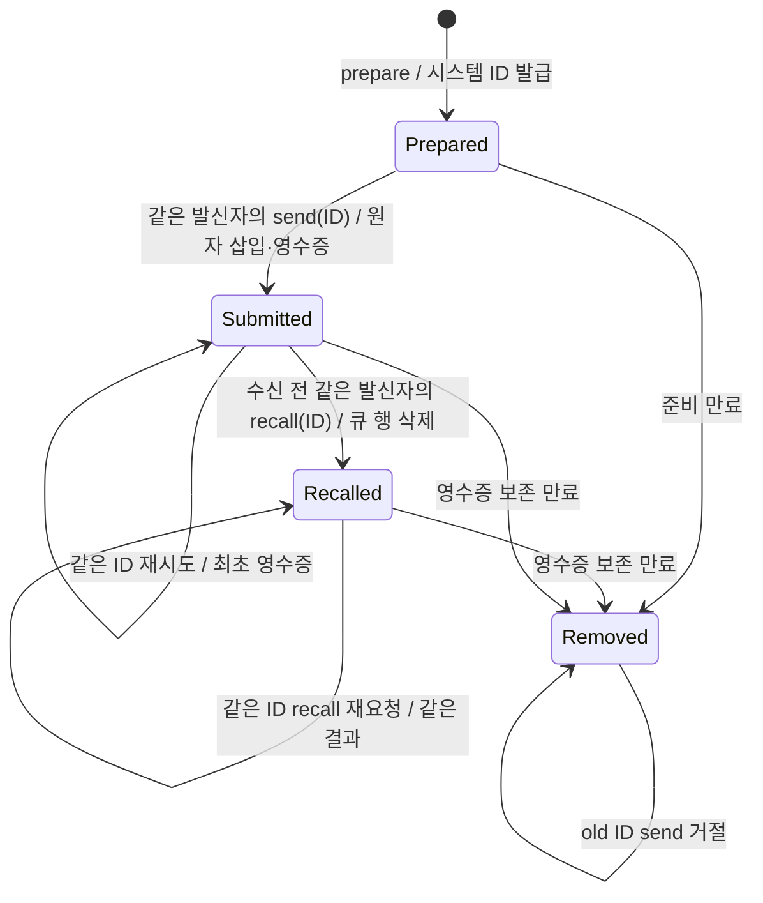
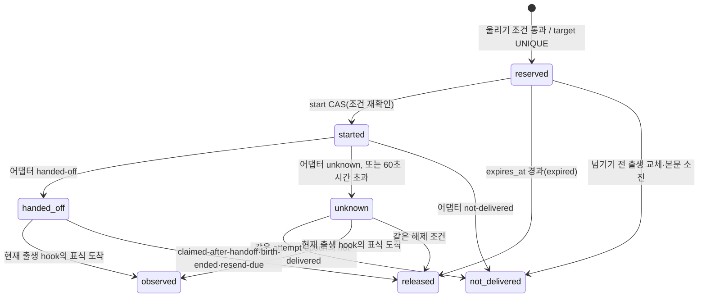

# 세션 메시지 계약

세션 메시지의 ID 발급, 재시도, 회수, ACK, 깨우기(초인종), presence와 peer 결과 대기 판정의 계약을 정리한다. 사용자용 설명은 [세션 협업](../user/collaboration.md)에 있다.

**읽는 법:** 3.0부터 broker 프로세스·TLS 연결·endpoint 파일은 없다. 각 프로세스가 공통 연산 표(`mcp-server/src/session-message-operations.ts`)를 자기 프로세스 안에서 실행하고, 연산 하나는 공유 SQLite의 `BEGIN IMMEDIATE` transaction 하나다. 아래 절 가운데 2.x 판에서 쓴 부분은 「broker」를 그 공통 연산 표를 실행하는 쪽으로 읽는다. 2.x broker의 endpoint·프로토콜 표지(`claim-receipts-v1`, `claimReceiptVersion`, `BROKER_CLAIM_RECEIPTS_REQUIRED`)는 현재 코드에 없으며, 그 서술은 2.x 기록이다.

## 메시지 ID와 재시도

릴레이의 기존 5초 주기는 `relay-tick` 한 요청으로 현재 세션 세대와 relay lease를 확인하고 두 heartbeat를 함께 갱신한다. pending 조회는 해당 transport가 필요한 경우만 포함한다. 오래된 세대·종료된 presence·만료된 lease는 갱신하지 않으며, heartbeat 자체는 실제 wake 관측이 아니다.

2.6.0의 새 메시지는 `prepare_session_message`로 준비하고 반환된 `messageId`만 `send_session_message`에 전달한다. 준비는 발신자·대상·본문·TTL을 고정하며 수신 큐·peer 관계·wake에 영향을 주지 않는다. ID는 공통 broker가 발급하고 기존 메시징 SQLite에 보존한다. caller가 ID를 만들거나 전송 때 내용을 바꿀 수 없다.



`schemaVersion: "1.0.0"`, `targetHost`, `targetSessionId`, `body`, 선택 `ttlSeconds`로 prepare를 호출한다. 이어 `schemaVersion`과 반환된 `messageId`로 send를 호출한다. 발신자 주소는 서버가 검증한 호출자의 `{host, sessionId}`이며 child 호출은 root 세션을 대신한다. 인자로 신원을 넣으면 거절하며, 별도 사용자의 승인·principal을 만들지 않는다. 발급되지 않은 ID, 다른 sender, send의 추가 body/target/TTL은 큐 삽입 없이 거절한다.

prepare 응답이 유실되어 다시 준비하면 사용하지 않는 draft가 남을 수 있지만 전달은 일어나지 않는다. send 응답이 유실되면 이미 알고 있는 같은 발급 ID로 `get_session_message_status`를 조회하거나 send를 재시도한다. 최초 큐 삽입과 제출 상태·영수증 저장은 같은 `BEGIN IMMEDIATE` transaction으로 확정한다. broker 재시작이나 다른 연결의 동시 send에도 같은 ID로 다시 삽입하거나 expiry를 늘리지 않는다.

**unknown ID는 전송이 없었다는 증거가 아니다.** 이미 전송한 기록이 정리됐을 수 있으므로 보관한 영수증과 대조한다. 불명확한 전송을 무조건 새 prepare로 다시 보내지 않는다. 새 prepare는 새 전송 의도에 사용한다. 수신 모델의 업무를 exactly-once로 실행한다는 보장은 없다.

| 저장 대상 | 경계 |
| --- | --- |
| 미전송 draft | prepare부터 10분; sender별 100개, 전역 1000개 |
| 제출 영수증 | 전역 1000개, sender별 250개; 미ACK 메시지는 최초 메시지 expiry 이후 1시간, ACK된 메시지는 `min(메시지 expiry+1시간, 최초 ACK+1시간)`까지 보존 |
| draft·영수증 전체 | record JSON의 UTF-8 byte 합 최대 4 MiB; 전송 뒤 본문 중복 저장 제거 |
| 실제 수신 큐 | 기존 미ACK 메시지 최대 1000개·본문 합 4 MiB |
| 메시지 TTL | 첫 send부터 30~86400초, 기본 3600초 |

상한에서는 명시적으로 거절하며 미만료 기록을 강제로 지우지 않는다. 영수증이 정리된 ID도 unknown으로 거절해 새 메시지가 생기지 않는다.

sender별 영수증 상한은 협력하는 세션 사이의 공정성 장치다. sender는 host hook이 결속한 세션 식별자일 뿐 인증된 principal이 아니므로, 같은 OS 사용자의 의도적 우회를 막는 할당량으로 보지 않는다. send는 같은 transaction에서 정리 뒤 sender 상한, 전역 상한 순으로 검사하는 권위 검사다. prepare도 같은 방식으로 영수증 용량을 먼저 확인해 이미 상한에 닿았으면 draft를 만들지 않고 `no draft was created`로 거절한다. 이 prepare 검사는 입장 확인일 뿐이며, prepare와 send 사이에 용량이 차면 send가 거절하고 해당 draft는 준비 만료까지 남는다.

영수증 용량 거절은 효과가 없었음이 확정된 거절이다. 메시지는 큐에 들어가지 않았고 영수증도 발급되지 않았다. 도구 응답의 `error.code`는 기존 `MCP_UNAVAILABLE`이고, `error.details`에 `scope`(`sender` 또는 `global`)와 해당 범위에서 가장 먼저 만료되는 기록의 시각 `earliestReleaseAt`을 담는다. 그 시각 뒤에는 새 prepare가 성공할 수 있지만 다른 sender가 먼저 용량을 쓸 수 있으므로 보장은 아니다. send에서 거절된 `messageId`는 prepare 응답의 `expiresAt`(준비 만료)까지 `prepared`로 남는다. `earliestReleaseAt`이 그 `expiresAt`보다 이르면 그 시각 뒤 같은 `messageId`로 재시도할 수 있다. 그렇지 않으면 draft가 먼저 만료되므로 새로 prepare한다. 둘 다 하지 않는다. 둘 다 하면 한 의도가 두 메시지로 전달될 수 있다. 용량 거절을 받은 뒤 그 ID로 다시 send하지 않았는데 draft가 만료돼 같은 ID의 send가 unknown(`Issued message ID is unavailable`)으로 거절될 수 있다. 이 경우 그 ID는 앞선 확정 거절로 전달되지 않았음이 이미 확인됐으므로, 저장한 거절 응답과 대조한 뒤 새로 prepare해도 된다. 확정 거절 기록이 없는 unknown ID는 기존처럼 저장한 영수증과 대조하고 무조건 다시 준비하지 않는다. 응답을 받지 못한 불확실한 send는 이 경우가 아니며, 기존처럼 같은 ID로 status를 조회하거나 send를 재시도한다. 이전 broker에서 온 거절에는 `details`가 없으므로 기존 안내를 그대로 따른다.

ACK는 해당 수신 대상에 대해 broker에 claim 이력이 기록되고 원 인수 영수증이 일치하는 메시지만 처리한다. 인수 응답의 본문과 `claimReceipt`를 같은 처리 문맥에 보존하고, 처리한 `messageIds`에 대응하는 `receipts: [{messageId, claimReceipt}]`를 반환한다. 최신 영수증을 조회하거나 메시지 ID 캐시에서 자동 선택해 붙이지 않는다. 아직 인수하지 않은 메시지, 다른 수신 대상, 모르는 ID, 영수증 누락·불일치는 메시지 상태·제출 영수증 만료·세션 활동 시각을 바꾸지 않는다. 인수 이력은 전달 대상으로 선택했다는 기록이며 실제 소비·업무 완료·권한의 증거는 아니다. 임대만 만료되고 재인수가 없으면 원 영수증의 늦은 ACK는 성공한다. 다른 회차가 재인수하면 이전 영수증은 효력을 잃고 새 회차를 확정할 수 없다.

ACK는 처음 성공한 ACK에서만 영수증 만료를 줄인다. 두 번째 ACK, 대상이 아닌 세션의 ACK, 모르는 ID의 ACK는 만료를 바꾸지 않으며, 줄인 만료는 다시 늘지 않는다. 따라서 ACK 후 1시간이 지난 ID는 status가 unknown(`null`)이고 같은 ID의 send도 발급 ID 없음으로 거절한다. 이 규칙은 새로 기록되는 ACK에만 적용하며, 이전 버전이 ACK한 기존 영수증의 만료를 소급해 바꾸지 않는다. 영구 tombstone이나 별도 DB·daemon은 없다. status는 준비 상태, 기존 queued/delivered/acknowledged 상태 또는 큐 행이 정리된 뒤 제출 영수증과 `deliveryState: "unknown"`을 구별한다.

ACK 전 lease 재전달은 정상이며 같은 ID·본문을 유지한다. 중복 ACK는 최초 ACK 시각을 늘리지 않는다. ACK는 처리 확인으로, 업무 완료나 승인이 아니다. wake의 전달 결과가 불명확하면 기존 예약을 유지하고 새 wake 효과로 바꾸지 않는다. [peer 대기 판정](#peer-결과-대기-판정)의 nonce·generation·복귀 증거 만료 계약은 유지한다.

## 회수(3.9.0)

보낸 세션은 수신자가 아직 받지 않은 자기 메시지를 `recall_session_message`(`schemaVersion`, `messageId`)로 회수할 수 있다. 메일 발송 취소와 같은 정책이며 호스트와 관계없이 같은 MCP 도구다. 발신자는 send와 같이 서버가 검증한 호출자이고, child 호출은 root 세션을 대신한다. hook 없는 CLI에서는 `{"operation":"recall","payload":{"sender":{...},"messageId":"<ID>"}}`로 같은 연산을 부른다.

- **받지 않음**: 아직 어떤 claim(MCP claim, 도구 경계, 턴 끝, 깨우기 도착)도 가져가지 않은 큐 행(`claimed_at`이 비어 있음)이다. 회수는 한 `BEGIN IMMEDIATE` transaction에서 이 조건으로 큐 행을 지우고 제출 영수증에 `recalledAt`을 적는다. claim도 같은 writer lock 아래에서 행을 다시 읽으므로 회수와 claim이 겹치면 먼저 lock을 잡은 쪽 하나만 이긴다. 회수된 메시지는 대기 수와 깨우기 후보에서 빠지며 수신자에게 영영 전달되지 않는다.
- **이미 울린 깨우기**: 깨우기 신호가 이미 나간 뒤 claim 전에 회수하면 그 깨우기는 검증된 깨우기로 인식되고 메시지 0건으로 끝난다. 이는 기존 빈 깨우기 경로(`peer.wake.noMessage`)이며 hook 실패로 보고하지 않는다. 아직 울리지 않고 예약만 된 시도는 다음 정리에서 `not-delivered`로 끝나고, 다른 받을 메시지가 없으면 새 시도는 울리지 않는다.
- **응답**: 성공하면 `recalled: true`와 `status`(`state: "recalled"`, `recalledAt`, `receiptExpiresAt`)를 돌려준다. 같은 요청을 다시 보내면 같은 `recalledAt`과 `duplicate: true`를 돌려주고 아무것도 바꾸지 않는다. 회수할 수 없으면 `recalled: false`와 `reason`을 돌려주며 아무것도 쓰지 않는다. `delivered`는 수신자가 이미 받았다는 뜻이고 `status`에 `claimedAt`·`firstDeliveredAt`·`acknowledgedAt`이 있다. `expired`는 메시지 TTL이 지났다는 뜻이다. `not-sent`는 준비만 하고 보내지 않은 ID다. `unknown`은 `status: null`이며 다른 발신자의 메시지와 모르는 ID를 구별하지 않는다(`get_session_message_status`와 같은 관례).
- **보존**: 회수된 메시지의 제출 영수증은 ACK와 같이 `min(기존 보존 기한, 회수 시각+1시간)`까지 남고, 그동안 `get_session_message_status`는 `recalled`를 보여 준다. 같은 ID의 send는 큐에 다시 넣지 않고 기존 영수증(`recalledAt` 포함)을 `duplicate: true`로 돌려준다. 영수증 상한·바이트 합 계산은 기존과 같다.
- **혼합 버전**: 저장소 형식은 바뀌지 않는다(`recalledAt`은 영수증 JSON 안의 필드다). 같은 컴퓨터의 3.8.x 이하 연결은 회수된 메시지를 `submitted`·`deliveryState: "unknown"`으로 보이며, 큐 행이 없으므로 전달하지 않는다. 3.8.x 이하에는 회수 도구가 없다.

## 회차 영수증과 혼합 버전의 제약

새 인수마다 같은 트랜잭션에서 `claimReceipt`를 발급하고 본문과 함께 반환한다. 이 값은 `<deliveryAttempt>:<무작위 UUID>`이며 모델이 만들거나 수정할 값이 아니다. 훅 봉투의 `receipt.claimReceipt`가 원값이다. 공개 수신 확인 도구와 명령줄은 다음 형식으로 원값을 전달한다.

한 인수 응답의 전체 직렬화 크기는 기존과 같이 UTF-8 32,768바이트 이하다. 본문뿐 아니라 영수증을 포함한 응답 봉투 전체를 계산하므로 같은 본문 묶음도 이전보다 적은 수가 한 응답에 들어갈 수 있다. 요청의 최대 메시지 수는 상한이며 그 수를 한 번에 전달한다는 보장은 아니다. 바이트 상한 때문에 다음 메시지를 넣을 수 없으면 앞에서부터 담은 메시지만 인수하고 나머지는 큐에 남긴다. 소비자는 받은 묶음을 원영수증으로 확인한 뒤 다음 묶음을 인수하며, 전체 본문을 하나의 응답에 넣으려고 상한을 늘리거나 본문을 자르지 않는다. 메시지별 순서와 무손실 여부, 한글의 수신 조각 경계 처리는 이 배치 크기 변화와 별도로 검증한다.

```json
{"messageIds":["<원 messageId>"],"receipts":[{"messageId":"<같은 messageId>","claimReceipt":"<같은 인수 응답의 claimReceipt>"}]}
```

브로커는 `claim-receipts-v1` 기능과 엔드포인트의 `claimReceiptVersion: 1`을 표시한다. 새 클라이언트는 이를 지원하지 않는 실행 중 브로커를 `BROKER_CLAIM_RECEIPTS_REQUIRED`로 거부하며 별도 브로커를 자동으로 띄워 우회하지 않는다. 인수하는 다섯 연산은 요청 봉투에도 `claimReceiptVersion: 1`을 넣는다. 새 브로커는 이 표지가 없거나 다른 구형 소비자의 요청을 본문 인수 전에 거부한다. 이는 형식 지원 표시이며 호출자 인증이나 처리 완료 증거는 아니다. 조회 프레임은 그대로다.

메시징 저장소 형식은 2다. 이전은 기존 인수 회차를 `legacy_claim_attempt`에 한 번 보존하고 영수증·수신 확인 영수증 열을 추가한다. 공유 저장소의 이전 형식은 명시적 초기화 전까지 영역별 쓰기를 허용하지 않는다. 이전 뒤 이미 열려 있던 구형 연결도 새 회차를 영수증 없이 인수하거나 새 회차를 확정하면 데이터베이스 제약으로 거부된다. 구형 저장소 프로그램으로 되돌려 새 형식을 쓰는 복구는 지원하지 않는다. 운영 데이터 삭제·교체·수동 열 수정으로 우회하지 않는다.

이전 당시 이미 인수된 영수증 없는 역사 행은 기존 ID만의 수신 확인을 보존한다. 이 호환 분기는 이전에 여러 번 재인수된 행의 실제 처리자를 판별하지 못하므로 완전한 회차 소유권 보장을 제공하지 않는다. 해당 행도 새 프로그램의 첫 재인수부터 새 영수증을 요구한다. 구형 소비자 지원 중단과 역사 행 재전달·보류의 운영 선택은 설치 전에 기존 승인 범위와 대조해야 하며 이 구현이나 문서가 새 운영 권한을 부여하지 않는다.

세 호스트의 설치 파일 갱신만으로 살아 있는 이전 브로커나 소비자가 교체되지는 않는다. 기존 실행물 정상 종료·새 실행물의 기능 확인·원 영수증 왕복을 따로 검증해야 한다. 원 호스트 호출 증명의 도구명·인자 지문·호출 ID·유효기간·서명·일회 소비 검사는 유지하며 영수증으로 대신하지 않는다. 이 수정만으로 본문 직접 제출·유휴 깨우기·모든 실제 호스트 수용이 끝난 것은 아니다.

## hook 없는 CLI

`node mcp-server/dist/session-message-cli.mjs`의 stdin으로 아래 준비 요청을 보낸다.

```json
{"operation":"prepare","payload":{"sender":{"host":"spark","sessionId":"owner"},"target":{"host":"grok","sessionId":"worker"},"body":"검증 결과를 전달합니다.","ttlSeconds":600}}
```

성공 출력의 `data.messageId`를 보관하고 다음 전송 요청에 그대로 사용한다. 아래 ID 자리는 시스템이 반환한 실제 값으로 채운다.

```json
{"operation":"send","payload":{"sender":{"host":"spark","sessionId":"owner"},"messageId":"<returned-messageId>"}}
```

옛 send의 body/target/TTL이나 임의 ID 입력은 오류와 함께 종료하며 전달 효과가 없다. CLI도 broker와 같은 발급·보존·전이 계약을 사용한다. 본문과 비밀은 프로세스 인수에 넣지 않는다.

## 업데이트와 복구

기존 AGS MCP·relay·broker를 종료한 뒤 업데이트하고 재연결한다. 추가 `prepared_messages` 테이블은 기존 messages·키·nonce·presence 데이터를 보존한다. 기존 메시지는 계속 claim/status/ACK할 수 있지만 발급 이력이 없는 기존 ID로 새 send를 할 수 없다. 이전 broker와 섞이는 호환 경로는 이번 사용자 범위에서 제외했다.

문제가 생기면 운영 DB와 키를 지우지 않고 데이터를 보존해 조사한다. 구버전 재설치는 새 발급 ID·재시도 계약을 지킨다는 증거가 아니다. 새 테이블을 삭제하거나 DB를 덮어써서 복구하지 않는다. 실제 설치·실행 process의 후보 확인은 소스 검증과 별도로 수행한다.


## wake 알림: 초인종(doorbell) 모델

3.0의 wake는 "받은함을 보라"는 초인종이다. 본문 전달은 기존 claim/ACK가 맡고, wake는 본문 권한의 경계가 아니다. 본문은 nonce 없이도 턴 종료·도구 경계에서 인수된다. 설계와 근거는 [ags30-wake-doorbell-design.md](../archive/ags30-wake-doorbell-design.md)에 있다.

host에 넘긴 표식에는 수신 확인과 취소가 없다. Codex는 대기열을 영속 저장하고 Running·Interrupted·Shutdown 상태에서는 꺼내지 않는다. Claude는 보류한 메시지를 `dialogExpiry`(기본 5분) 뒤에 버린다. agy에는 표식 관측 hook 경로가 없다. 그래서 store는 표식의 소비를 기다리며 슬롯을 영구히 잠그지 않고, 시간과 본문 인수 경계로 슬롯을 비운 뒤 다시 울린다.

시도 하나가 `wake_nonces` 행 하나다. 대상당 활성 시도는 최대 하나이며(UNIQUE `wake_active_target`) 이것은 잠금이 아니라 슬롯이다. 재시도는 항상 새 행과 새 nonce로 하고, 끝난 행은 되살아나지 않는다. board의 `consume-wake`는 상태와 만료를 따지지 않고 이 대상의 표식으로 인식되는지만 확인한다.



`not_delivered`·`handed_off`는 저장값 `not-delivered`·`handed-off`다. `observed`·`released`·`not-delivered`는 끝난 상태다.

### 시도 상태

| 상태 | 의미 |
| --- | --- |
| `reserved` | 울리기로 정했고 아직 넘기지 않았다. 외부 효과가 없다. |
| `started` | start CAS를 통과했고 어댑터를 호출하는 중이다. |
| `handed-off` | host가 받았다고 응답했다. 소비 여부는 모른다. 전달이 아니다. |
| `unknown` | 넘긴 결과를 알 수 없다. |
| `observed` | 현재 출생의 hook이 이 표식을 봤다. |
| `released` | 관측 없이 끝났다. `release_reason`이 붙는다. |
| `not-delivered` | 확정적으로 넘기지 못했다. 외부 효과가 없다. |

- relay는 start CAS 때 transport 포트가 선언한 `resendBaseMs`를 `start-wake`에 넘기고, 결과를 `record-wake-outcome`에 넘길 때도 같은 값을 보낸다. broker는 양의 정수이고 24시간(`WAKE_RESEND_MAX_MS`) 이하가 아니면 요청을 거부한다. hook이 보낸 값은 쓰지 않는다.
- `started`가 60초(`WAKE_START_TIMEOUT_MS`) 안에 결과를 받지 못하면 `unknown`이 되고, 이때 `outcome_at`과 `resend_due_at`을 함께 쓴다. 이 값은 어댑터 호출 timeout(5~10초)보다 길다.
- 결과 기록은 `started`나 `unknown`이고 attempt와 dispatch epoch가 같은 행에만 적용한다. 끝난 행에 늦게 온 결과나 start는 행을 바꾸지 않는다. 출생 상태(아래)는 attempt와 epoch가 맞으면 갱신하므로 늦게 온 실패도 재시도 대기와 실패 집계에 들어간다.

### 넘긴 결과 분류

어댑터는 `handed-off`, `unknown`, `not-delivered{kind, reasonCode}` 셋 중 하나만 돌려준다. `handed-off`나 `unknown`을 기록하면 출생 상태의 연속 실패 수를 0으로 되돌린다.

- `not-delivered`·`transient`: 연속 실패 수를 1 늘리고 backoff(상한 10분) 뒤에 다시 시도한다. 연속 5회(`WAKE_FAILURE_LIMIT`)에 닿으면 보고는 `degraded`/`wake-failing`이고, 생존성을 위해 backoff 상한으로 계속 시도한다. 예: 시작 직후 Codex의 `No active session found`.
- `not-delivered`·`prerequisite-missing`: 이 출생의 실행 환경에 필수 조건이 없다(실행 파일 ENOENT, messaging socket·token env 없음, project id·agentapi 없음, 메타데이터 불일치). 이 출생 동안 다시 울리지 않고 보고는 `degraded`/`wake-prerequisite-missing`이다. 출생이 바뀌면 다시 시도한다.

`unsupported`는 결과 값이 아니라 능력 선언(`idleWake: none`이거나 `peer-wake` 미지원)에서만 나온다.

### 출생별 깨우기 경로 상태

`wake_paths` 표는 (host, session, instance, birth generation)마다 연속 무응답 수(`streak`), 연속 실패 수(`failures`), backoff 끝 시각(`retry_not_before`), 전제조건 결손 사유(`prerequisite_missing`), 마지막 본문 인수 경계 시각(`claim_boundary_at`)을 둔다. 새 출생은 0에서 시작한다. prune은 최신 live 출생이 아니면서 활성 시도도 없는 행을 지운다.

`claim_boundary_at`은 `claimTurnEnd`, `claimHostWake`, 건너뛰지 않은 `claimDeferred`가 쓴다. MCP `claim`은 현재 live 출생이 있을 때만 그 출생에 쓴다. `observeNativeInput`, `clearDeferred`, 건너뛴 `claimDeferred`는 활동만 기록하는 경로라서 경계가 아니다.

### 울리기 조건

reserve할 때 보고 start CAS 안에서 다시 확인한다.

1. 현재 출생의 presence가 online이고, relay lease가 live이고, `peer-wake`를 지원한다.
2. 인수할 수 있는 본문이 있다.
3. 활성 시도가 없다.
4. 출생 상태에 `prerequisite_missing`이 없고 `retry_not_before`가 지났다.
5. 조용함: `claim_boundary_at`이 60초(`WAKE_QUIET_MS`)보다 이전이다. 인수 가능한 본문 중 가장 오래된 것이 10분(`WAKE_QUIET_MAX_MS`)보다 오래 기다렸으면 이 조건을 무시한다. 이것은 바쁜 세션에 표식을 덜 쌓는 최적화이고 정확성 조건이 아니다. hook이 없는 긴 작업(Codex의 긴 단일 도구 호출)은 이 조건으로 알 수 없다.

### 넘긴 시도의 해제와 재울림

`handed-off`·`unknown` 행은 다음 가운데 하나가 참이면 `released`가 된다.

| `release_reason` | 조건 |
| --- | --- |
| `claimed-after-handoff` | 출생 상태의 `claim_boundary_at`이 넘긴 시각(`outcome_at`) 이후다. 그 경계에서 대기 본문은 인수됐다. 표식 소비의 증거는 아니다. agy처럼 표식을 관측하지 못하는 host는 이 조건으로 슬롯을 비운다. |
| `birth-ended` | 시도의 출생이 더 이상 최신 live 출생이 아니다. |
| `resend-due` | `resend_due_at`이 지났다. |

`resend_due_at`은 `outcome_at + min(resendBaseMs × 2^streak, 24시간)`이다. `resend-due`로 끝나면 `streak`가 1 늘고, `observed`, `claimed-after-handoff`, 넘긴 시각 이후의 표식 도착 인수에서 0으로 돌아간다. `birth-ended`와 `not-delivered`는 streak를 바꾸지 않는다. 그래서 응답 없는 출생에 넘긴 시도 수는 `⌈log2(경과 시간/base)⌉ + 1` 이하이고, 24시간 상한에 닿은 뒤로는 하루 1개다. 조용한 live 세션은 무한정 막히지 않는다.

| transport | 넘기기 | `resendBaseMs` |
| --- | --- | --- |
| `codex-queue` | `codex queue --thread` | 20분 |
| `claude-inbox` | messaging socket(`priority:"next"`) | 10분 |
| `antigravity-queue` | `agentapi send-message` | 10분 |
| `codex-deferred`, `gemini-deferred` | 없음(`idleWake: none`) | — |

`reserved`는 `expires_at`이 지나면 무조건 `released`(이유 `expired`)가 된다. 넘기기 전에 다른 출생으로 바뀌었거나 본문이 모두 인수됐으면 `not-delivered`로 끝난다. 해제는 reserve·send·status 같은 기존 prune 지점에서 일어난다. 조회 도구인 `list_session_status`와 `get_session_message_status`도 prune을 부르므로 만료 기록 삭제와 해제를 일으킬 수 있다. 이 정리는 멱등이다.

공통 relay는 outcome·capability·dispatch 포트만 쓴다. transport 등록과 vendor 연결은 `wake-transport-*` 모듈과 조립 모듈 `wake-transports.ts`에 두고, 공통 상태에는 vendor 분기가 없다. 이 경로는 host 대기열의 목록·취소·삭제를 호출하지 않는다.

### hook 관측 경계

관측은 실제 `UserPromptSubmit` hook에서 adapter가 해석한 marker-only 입력과 기존 TrustStore의 비권위 source receipt를 함께 보낸다. broker는 저장된 서명·대상·정규화한 관측 digest·receipt TTL을 검증한 뒤 `BEGIN IMMEDIATE` 안에서 nonce, 현재 presence instance/birth generation과 claim 가능 본문을 확인한다. 일반 caller의 `approved`, normalized 입력 자칭, nonce 문자열만으로 관측을 만들 수 없다. 일반 peer 본문 receipt도 wake hook receipt로 사용할 수 없다. receipt 발급은 hook 코드에 있으며 공개 MCP 발급 도구는 없다.

receipt는 `authorityEffect: none`이다. 이 검사는 협력하는 로컬 hook 경로의 liveness provenance를 결속한다. 같은 OS 사용자가 코드를 실행하거나 source key를 변조할 수 없다는 보장, 사용자 승인·신원·업무 완료·W06 권위 채널 자격을 만들지 않는다.

- 현재 출생의 표식: 검증된 표식의 행이 현재 presence와 결합(instance·birth·transport·online·peer-wake)이 같으면 대기 본문을 인수한다. 행의 상태와 nonce 만료는 따지지 않는다. 활성 행이면 `observed`로 바꾸고, 이미 끝난 행이면 `late_observed_at`만 기록한다. 출생 상태의 `claim_boundary_at`도 갱신한다. 관측과 본문 claim은 한 transaction이며 batch/response budget 오류가 나면 둘 다 rollback한다.
- 다른 출생의 표식: 본문을 인수하지 않고 도착 증거만 남긴다.
- 끝난 행은 24시간(`WAKE_RESEND_MAX_MS`) 동안, 최대 1000행까지 보관한다. 보관 기간이 지난 뒤 도착한 표식은 미등록 nonce로 인식되지 않고 본문도 인수하지 않는다.
- 인수한 본문이 없고 행이 모두 끝난 상태면 응답에 `retired: true`가 붙는다. claim lease가 만료된 뒤 늦게 온 표식은 기존 재전달 규칙(lease 만료 → 재인수)처럼 본문을 다시 받을 수 있다. 중복 처리는 receipt·ACK와 수신자의 messageId 기준 중복 제거로 막는다.

delivery profile의 `blocksEmptyWakePrompt`가 켜진 host의 hook은 현재 managed wake가 검증됐는데 인수한 본문이 없거나(`recognized: true`, 빈 messages), 끝난 시도의 marker만 왔을 때(`retired: true`) `UserPromptSubmit`의 `decision: block`으로 그 marker prompt를 모델 요청 전에 막는다. host 화면에 marker가 한 번 보이는 것은 막지 않는다. Claude와 Codex가 이 값을 켠다. Codex 0.166.0은 이 block에서 모델 요청 없이 턴을 끝내고 그 prompt를 thread 기록에 남기지 않았다(로컬 가짜 provider로 측정: block 0회, 허용 1회, D0054). Gemini는 peer-wake가 없고, Antigravity는 prompt를 넘기지 않아 wake-only prompt가 관측되지 않으므로 false다.

store가 인정하지 않은 marker(미등록·정리됨·다른 출생·검증 실패, `retired` 아님)만으로 된 prompt도 그 hook 세대의 턴을 시작한다. 그래서 hook은 `claim-wake-input`으로 그 경계에서 대기 본문을 인수해 붙인다(D0015). 이 인수는 tool 경계처럼 hook instance로 세대를 가르고 같은 claim lease를 쓰므로, ACK 전에 다른 경계가 같은 본문을 다시 넘기지 않는다. marker는 아무 권한도 주지 않아 wake 행은 바뀌지 않는다. 붙일 본문이 없으면 `blocksEmptyWakePrompt` host는 그 prompt를 막는다. marker와 사용자 글이 섞인 prompt나 보통 사용자 prompt는 이 처리 대상이 아니다. `Stop`의 같은 decision은 continuation을 뜻하므로 이 처리에 쓰지 않는다. 메시지 전달 자체를 exactly-once 업무 실행으로 확대하지 않는다.

`wake-status`와 메시지 status의 `wake` diagnostic은 시도의 상태·해제 이유·시각을 보여 주며 본문이나 nonce는 포함하지 않는다. `wake-status`는 대상의 최신 시도다. 메시지 status의 `wake`(3.6.0부터)는 그 메시지가 대기 중일 때(생성부터 ACK까지) 시작된 시도만 보여 주고, 없으면 `null`이다. 시도는 대상에 인수할 본문이 있을 때만 시작되므로 그 시도는 이 메시지를 위해 울렸다. 아직 시작하지 않은(`reserved`) 시도, 메시지보다 먼저 시작했거나 ACK 뒤에 시작한 시도는 보이지 않는다. 3.5.x까지는 메시지와 무관하게 대상의 최신 시도를 보여 줬다.

### capability

| adapter | 주입과 idle 깨우기 | 넘긴 뒤 의미 |
| --- | --- | --- |
| claude-inbox | peer-wake·tool-boundary·turn-end, silent next | `handed-off`는 전달이 아니다 |
| codex-queue | peer-wake·tool-boundary·turn-end, user-message | `handed-off`는 전달이 아니다 |
| codex-deferred | tool-boundary·turn-end, idle wake 없음 | idle 알림 발송 0, `unsupported` |
| antigravity-queue | peer-wake·tool-boundary, user-message | 관측 hook이 없어 `claimed-after-handoff`·`resend-due`로 해제 |
| gemini-deferred | idle wake 없음 | idle 알림 발송 0, `unsupported` |

antigravity의 queue wake 설정 env는 `AGENT_GOVERNANCE_ANTIGRAVITY_QUEUE_WAKE`다. 3.0은 옛 transport 이름 `gemini-queue`와 옛 env 이름을 받지 않는다.

### 보장과 남은 조건

- 위조한 nonce나 출처를 세탁한 표식으로 본문을 인수할 수 없고, 이전 출생의 표식은 현재 출생의 본문을 인수할 수 없다.
- 독립된 두 연결이 동시에 울려도 외부 호출은 한 번이다(start CAS). 결과를 기록한 뒤 응답을 잃어도 바로 다시 울리지 않는다.
- 미확인을 성공으로 보고하지 않는다. `handed-off`·`unknown`·`released`는 전달·소비의 증거가 아니고, status의 `deliveryState`를 바꾸지 않는다.
- Esc로 중단된 Codex 세션은 사용자가 재개할 때까지 어떤 설계로도 깨울 수 없다. 상태는 `wake-unanswered`로 보인다.
- Codex의 긴 단일 도구 호출 중에는 hook이 없어 조용함 조건이 동작하지 않는다. 그동안 붙잡힌 표식 1개가 턴이 끝날 때 나갈 수 있다.
- Claude 소켓의 `priority:"next"`와 agy의 `agentapi send-message`는 공개 계약이 아니다. 독립 모드는 시계가 단조가 아니어서, 시계가 뒤로 가면 그 폭만큼 상한이 늘어난다.
- 이 저장소 불변조건은 실제 host 대기열 항목 수의 실측을 대신하지 않는다. 적용 전 잔류 항목과 혼합 writer는 별도 검증 대상이다.

### 자동 깨우기 신호(autoWake)

`send_session_message`의 결과와 `get_session_message_status`의 미ACK 큐 행, 세션 현황판의 presence에는 조언용 `autoWake`가 붙는다. 계약은 `contracts/session-auto-wake-outlook.v2.schema.json`이며 `authorityEffect: "none"`이다. 발신 성공은 broker가 큐에 넣었다는 뜻이고, `autoWake`는 수신자의 idle 깨우기 경로를 지금 쓸 수 있는지에 대한 사실만 보고한다. 예측하지 않는다. 전달, 처리, 완료, 승인이나 권한의 증거가 아니고, 큐의 메시지를 지우거나 다시 보내지 않는다.

| state | reason | basisAt |
| --- | --- | --- |
| `available` | `relay-live`: 울릴 수 있다 | relay lease 갱신 시각 |
| `available` | `wake-in-flight`: 넘긴 뒤 관측창(60초) 안이다 | 넘긴 시각 |
| `available` | `wake-unanswered`: 관측창이 지났고 응답 근거가 없다. host가 붙잡았거나 버렸을 수 있다 | `resend_due_at` |
| `available` | `recipient-active`: 최근에 본문 인수 경계를 지났다 | `claim_boundary_at` |
| `available` | `retry-backoff`: 일시 실패 뒤 대기 중이다 | `retry_not_before` |
| `degraded` | `wake-failing`: 연속 일시 실패가 상한에 닿았다 | 마지막 실패 시각 |
| `degraded` | `wake-prerequisite-missing`: 이 출생에서 깨우기 전제조건이 없다. 경계 인수만 남는다 | 판정 시각 |
| `unsupported` | `no-idle-wake`: 능력 선언상 깨울 수 없다 | presence birth |
| `no-live-relay` | `presence-unknown`, `presence-not-online`, `relay-lease-missing` | 없음, presence lease 종료, 마지막 presence heartbeat |

`degraded`이면 메시지는 큐에 남고, 상대가 자기 턴 종료·도구 경계·입력에서 인수할 때까지 늦을 수 있다. 송신자는 상대의 처리가 지금 필요할 때만 확인된 전달 상태와 이 지연 가능성을 사용자에게 알린다.

presence lease가 끝나고 live relay가 없으면 presence `state`는 `unreachable`이나 `ended`이고 `autoWake`는 `no-live-relay`다. 현황판은 오래된 online을 보여 주지 않는다. relay는 SessionStart hook에서 뜬다. 그 뒤에는 주 세션의 입력, 도구 실행 뒤 경계와 턴 종료 hook이 현재 세대에 live relay가 없다는 broker 응답을 받았을 때만 그 세대의 relay를 다시 띄운다. 어댑터가 검증된 복구를 켰으면 `list-presence`가 내보내는 명시적 `relayLive`로 확인한 뒤(autoWake에서 추정하지 않는다) 시작 grant(`ensure-relay`)를 받고, 아니면 입력 관측·claim·`clear-deferred` 응답의 복구 정보로 한 번만 시도하며, 그 hook의 host process가 해당 세대가 보고한 host birth와 다르면 사유를 기록하고 띄우지 않는다. 이런 hook이 아직 실행되지 않은 세션, 예를 들어 재부팅 뒤 아직 turn이 없는 Codex 세션은 `no-live-relay`로 보이며 메시지는 큐에 남는다. broker가 답하지 않은 identity의 `autoWake`는 `null`이다.

Codex hook(3.6.0): Windows의 입력·도구 뒤·턴 종료 명령은 host PID를 계산해 넘기지 않고 PowerShell 자기 PID(`--host-shell-pid $PID`)만 넘긴다. hook은 그 셸이 자기 부모인지 확인하고, 위 복구가 실제로 필요할 때만 OS 조회(CIM)로 셸의 부모, 곧 Codex PID를 읽는다. 그 PID를 세대가 보고한 host와 비교하는 규칙은 같다. SessionStart·SessionEnd와 Linux·macOS(`--host-pid "$PPID"`)는 바뀌지 않는다. Windows에서 hook마다 돌던 조회가 hook 시간의 대부분이었다(2026-11-04 측정, AGS 3.5.3: 한가할 때 75%, 동시 8개 85%).

Codex hook 명령의 실행 상한(3.6.0): `hooks/hooks.json`의 `timeout`(10초)은 node가 뜨기 전 단계(플러그인 신뢰 hash, Windows PowerShell 시작)까지 센다. 그래서 `session-message-hook` 진입점은 node 시작부터 `10초 − 3초(시작 전 몫) − 0.5초(stdout 몫)` = 6.5초를 상한으로 쓴다(`HOOK_COMMAND_BUDGET`, 시험이 hooks.json timeout과 맞는지 확인한다). 본문 claim은 상한까지 1초 이상 남았을 때만 시작한다. 상한에 걸리면 기존 실패 보고(`peer-hook-failure`)에 `phase`, `reason: HOOK_BUDGET_EXPIRED`(messaging 요청 안이면 `BROKER_DEADLINE_EXPIRED`)와 멈춘 단계 `step`(요청 이름, `host-pid`, `wake-observation`, `peer-receipt`, `peer-envelope`, `relay-launcher`)을 남기고 아무것도 출력하지 않는다. 상한 아래에서는 출처 영수증 저장소가 잠금을 기다리지 않는다(busy timeout 0). 잠겨 있으면 그 단계가 사유를 남기고 실패한다. claim 뒤에 실패하면 그 본문은 claim lease가 끝날 때까지 다시 전달되지 않고, 끝난 뒤 다음 경계에서 다시 인수된다. 동기 SQLite 대기 자체는 끊을 수 없으므로 10초 안 종료를 보장하지는 않는다. SessionEnd는 Codex 기본 1초(최대 3초) 제한을 그대로 받는다.

#### 세대 식별(C2)

presence birth는 ms 해상도 ISO 문자열이다. 같은 instance가 이전 birth와 같은 ms에 다시 태어나면 두 세대가 같은 문자열을 가져, 이전 birth의 nonce가 현재 세대 claim을 얻을 수 있었다. `startPresence`는 rebirth의 시각이 이전 birth보다 늦지 않으면 이전 birth에 1ms를 더한 값을 쓴다. 살아 있는 lease의 갱신은 birth를 바꾸지 않는다. 별도 세대 ID 컬럼은 추가하지 않았다. 보존 기간이 지나 행이 지워진 뒤의 재등록은 아래 presence 보존 절을 따른다.

#### presence 보존과 현황판 조회

2.7.3까지는 `session_presence` 행을 지우는 코드가 없어 끝난 세션의 행이 계속 쌓였다(2.7.2부터 잠재). 현황판 조회는 broker의 `list-presence`가 저장된 모든 identity를 한 응답으로 돌려주었고, 응답이 한도(32 KiB)를 넘으면 client가 거절해 현황판의 모든 presence가 `unknown`, `autoWake`는 `null`이 되었다. store의 판정은 맞았고 전송 한도에서 막혔다.

보존: `prune`은 lease 끝(`lease_until`, 종료한 행은 종료 시각과 같다)이 24시간보다 오래된 presence 행을 지운다. 24시간은 현황판이 세션을 보여 주는 창(board의 24시간 보존)과 같아서, 현황판에 보이는 동안 끝난 세션은 `ended`나 `unreachable`로 보인다. 살아 있는 행(`ended_at` 없음, lease 유효)은 lease 끝이 미래이므로 지워지지 않는다. 같은 identity에 살아 있는 행이 있는 동안에는 그 identity의 가장 최근 행(birth 기준)도 남긴다. presence 조회, `birth-ended` 판정과 `autoWake`는 모두 이 가장 최근 행만 읽으므로, live identity의 presence, 해제 판정과 `autoWake` 상태는 정리 전후에 같다. live 행이 없는 identity는 다르다. 가장 최근 행이 지워지면 더 이른 행이 최신이 되어 표시되는 instance, 상태(`ended`/`unreachable`)와 기준 시각이 바뀔 수 있고, 행이 모두 지워지면 등록된 적 없는 identity처럼 `unknown`이며 `autoWake`는 `no-live-relay`/`presence-unknown`이다. 메시지, 영수증, wake 행과 relay lease 규칙은 바뀌지 않는다. 정리는 DELETE 한 문장이라 멱등이다.

검증된 부모 세대 기록이 없는 일반 presence에서 행이 지워진 instance가 다시 등록되면 새 행으로 들어가 birth가 등록 시각이 된다. 지워진 행은 lease 끝이 24시간 전보다 이르고 birth는 그보다 이르므로, 시계가 되돌아가지 않는 한 새 birth는 이전 wake의 birth generation보다 크다. 이는 부모 프로세스의 실제 생성 순서를 증명하지 않으며, 이미 정리된 역사 세대의 재등록을 구별하는 근거가 아니다.

##### 검증된 부모 세대 보존과 교체

AGS-D-0354 수리 뒤 broker가 실제 확인한 부모 PID와 출생토큰은 기존 `session_presence` 행에 보존한다. 이 행은 위의 시간 기반 정리에서 제외한다. 새 세대 B를 등록하고 이전 세대 A의 교체를 확정하는 작업은 같은 트랜잭션으로 처리한다. 교체된 A는 현재 presence 선택에서 제외하지만 A의 재등록을 거부하는 근거로 남긴다. 정상 미등록 C는 자신이 관측한 현재 B가 그대로인지 비교한 뒤 등록한다. 해시, 등록 시각이나 출생토큰의 문자열 순서로 세대의 전후를 추론하지 않는다.

기존 요청은 전체 presence 행 중 한 행씩 순환해 정리 후보를 읽는다. 이미 검증한 같은 PID의 다른 출생토큰 또는 PID 조회의 `ESRCH`로 원 신원의 사망을 확인한 경우만 삭제하며, 삭제 때 행과 보존한 세대 근거가 그대로인지 다시 비교한다. 권한 오류, 조회 실패·취소·시간 초과는 사망 근거가 아니다. 새 행이 계속 추가돼도 기존 순회 구간을 먼저 끝내며, 별도 주기나 프로세스는 추가하지 않는다. 요청의 기존 남은 예산을 넘으면 삭제하지 않는다. 살아 있거나 사망이 불명확한 보호 기록 총량에는 고정 상한이 없으므로 전체 저장소의 크기가 제한된다고 보장하지 않는다.

형식 번호 2를 유지하며 기존 행에 nullable 열 세 개를 추가한다. 보장은 수리된 broker가 실제 검증해 보존한 세대부터 적용된다. 이미 정리된 A의 이력은 사후 복원할 수 없고, 출생토큰의 동일 tick·재부팅 식별 한계를 넘는 보장을 추가하지 않는다. 구형 writer는 새 보호 열을 모르므로 혼합 실행의 보호를 보장하지 않는다. 설치 전 기존 생산자의 정상 종료와 세대 단절 확인은 별도 실행·검증 대상이며, 파일 생성이나 새 설치만으로 과거 살아 있는 A가 사라졌다고 판단하지 않는다.

조회(3.0): 현황판은 broker 요청 `list-current-presence {self}` 한 번으로 생존 여부를 받는다. broker는 store의 `listCurrentPresence`를 그대로 부른다. 각 세션의 최신 출생 가운데 online이거나, 끝나지 않았고 lease가 끝난 지 10분이 안 된(`unreachable`) 것만 heartbeat 내림차순으로 돌려주고, 호출한 세션은 상태와 관계없이 맨 앞에 둔다. 응답은 한도(32 KiB)보다 4 KiB 작은 예산까지만 담고 나머지는 `truncated`로 센다. 끝난 세션은 요약이 있어도 현황판에 나오지 않는다. broker가 답하지 않으면 현황판은 목록을 추측하지 않고 `MCP_UNAVAILABLE`(`step: "presence"`)을 돌려준다. `list-presence`는 hook의 relay 복구 확인용으로만 남고 `targets`(1~3개)가 필수다. 2.x의 대상 없는 요청과 3개씩 묶는 service 조회는 없앴다. 설계: [`docs/archive/ags30-session-board-design.md`](../archive/ags30-session-board-design.md).

broker는 relay가 주기적으로 요청하는 동안 종료되지 않으므로, 업데이트 뒤에도 이전 broker가 계속 돌 수 있다. 앞의 안내대로 기존 AGS MCP·relay·broker를 종료한 뒤 재연결한다.

#### 이관(3.0, user_version 3)

CHECK와 DEFAULT `'legacy'`는 제자리에서 바꿀 수 없으므로 `wake_nonces`를 한 transaction 안에서 다시 만든다. 기존 상태는 `submitted`→`handed-off`, `not-submitted`→`not-delivered`, `expired-unobserved`→`released`(이유 `migrated`), `started`→`unknown`으로 옮기고, `legacy` 행은 지운다. `late_observed_at`이 있는 옛 `unknown`도 `released`(이유 `migrated`)가 된다. 옮긴 활성 행(`handed-off`·`unknown`)에는 `outcome_at`(없으면 `started_at`), `resend_base_ms` 10분과 `resend_due_at = outcome_at + 10분`을 채워 영구히 잠기지 않게 한다. `wake_active_target`은 새 활성 상태 목록으로 다시 만들고, `wake_paths`는 기존 활성 행의 출생마다 streak 0으로 채운다. 옛 transport 값 `gemini-queue`는 presence·relay lease·wake 행에서 `antigravity-queue`로 바꾼다. 도중 실패는 전체를 rollback한다. 2.x broker는 version 3 DB를 열지 못한다(더 높은 version 거절). broker 프로토콜 버전도 2.0.0으로 올라가므로 2.x client·relay와 섞이지 않는다. 기존 AGS MCP·relay·broker를 종료한 뒤 업데이트한다.

독립 process fixture와 번들 검사는 실제 host 설치·wake 관측을 대신하지 않는다. 실제 설치·양 host 실측은 별도 W07/출하 검증이며 로컬 PASS로 승격하지 않는다.

## peer 결과 대기 판정

2.6.0은 메시지 전송, 호출 전 제한, 턴을 끝낸 뒤의 복귀를 별도 기능으로 다룬다. 메시지나 ACK가 존재한다는 사실은 업무 완료나 승인을 뜻하지 않는다.

### 실행 경계

| 경로 | 관측과 실제 효과 |
| --- | --- |
| 지원 Codex hook | `PreToolUse`의 정확한 `mcp__codex_app__wait_threads` 이름과 `targets[].threadId`, 로컬 `hostId`, `timeoutMs`를 읽는다. main actor가 관측되고 아래 조건이 충족되면 호출 전에 `permissionDecision: deny`를 반환한다. |
| hook 없는 기존 CLI | stdin의 `wait` 작업이 같은 판정을 받은 뒤 실제 delay 실행 여부를 결정한다. 거절 시 추가 조회·delay가 없고, 복귀 미확인이면 최대 1000ms 대기 후 한 번만 갱신한다. |
| 그 밖의 native 호출 | AGS가 실행 경계를 소유하지 않는다. 안내만 가능하며 MCP 서버가 호출을 가로막는다고 주장하지 않는다. |

The exact local Codex app `mcp__codex_app__wait_threads` hook surface is adapted separately from the host-neutral peer wait policy. All targets must correspond to unexpired peer metadata, and the hook must observe a main actor. A fresh current-generation presence, an instance-bound live relay, and a wake nonce reserved and consumed in that same generation are required for enforcement. Unknown, stale, mixed-target, remote, unsupported-tool and unknown-actor cases cannot create resume evidence. The hook can deny before the native call; the MCP server cannot intercept unrelated native calls or code nested in arbitrary execution tools. The portable CLI `wait` operation consumes the same decision before its own delay. A receipt, ACK, transport name or supplied JSON capability is not task completion, approval or proof of resume. Neither path creates a timer or poller while idle.

강제 제한에는 다음 관측이 모두 필요하다.

1. 모든 대상에 현재 hook 결속 sender와 주고받은 만료 전 peer 메시지 메타데이터가 있다. 서로 다른 채팅이나 관계가 미확인인 대상이 섞이면 제한하지 않는다.
2. sender presence가 online이며 최신 instance의 lease가 유효하다.
3. 현재 instance의 relay lease가 live이고 그 relay가 host 출생을 결속했다(`host_start`). PID 생존은 확인 근거로 쓰지 않는다. relay가 죽으면 lease가 15초 안에 끝난다.
4. 같은 instance와 relay에서 예약된 nonce가 실제 host wake hook의 `claim-host-wake`에서 유효하게 소비되었으며 그 관측이 30초 이내이다. 기능 선언·브랜드·ACK·caller JSON만으로 이 증거를 만들지 않는다.
5. presence에 `peer-wake` 주입과 `idleWake`가 선언되어 있으며 wake visibility와 일치한다. `none`은 복귀 가능한 상태로 취급하지 않는다.

복귀가 확인된 peer 대기의 positive timeout은 거절한다. `timeoutMs: 0`은 첫 조회를 허용한다. 같은 대상·peer 상태·관측 cursor의 반복 조회만 30초 동안 억제하며, 거절된 반복은 만료 시각을 연장하지 않는다. peer 메타데이터나 cursor 변화, 새 사용자 입력 또는 기록 만료는 첫 조회를 다시 허용한다. `get_session_message_status`, 일반 sleep·셀 대기·프로세스·테스트 대기는 이 native 제한 대상이 아니다. 명시적인 사용자 대기 의도를 임의 regex나 `approved` 필드로 추정하지 않는다.

복귀가 없거나 불명확한 상태에서는 대기를 일괄 금지하거나 세션 종료를 강제하지 않는다. 제한된 조회·대기를 사용하고 다음 사용자 턴에 이어가라는 안내를 반환한다. 최초 wake, nonce 예약 때의 generation을 확인할 수 없는 과거 wake, 관측 만료 직후에는 복귀를 미확인으로 둔다. 따라서 이 변경은 모든 첫 대기를 차단하는 기능이 아니다.

native 요청은 JSON 키 순서, `hostId` 생략과 `local`, target 배열 순서, 동일 target·cursor 중복을 같은 의미로 정규화한다. 공통 판정도 target identity를 정렬·중복 제거한 뒤 상태 fingerprint와 억제 key를 계산한다. 실제 target이나 cursor 변화는 보존하며, 같은 target에 서로 다른 cursor가 있으면 distinct cursor 전체를 정규화된 revision에 남긴다. `afterCursor`는 생략 또는 문자열만 지원하며 형식이 다르면 native 강제 제한 경로로 진입하지 않는다.

### 공개 CLI

```json
{"operation":"wait","payload":{"sender":{"host":"spark","sessionId":"owner"},"targets":[{"host":"grok","sessionId":"worker"}],"timeoutMs":60000}}
```

이 JSON을 `node mcp-server/dist/session-message-cli.mjs`의 stdin으로 전달한다. 출력의 `data.decision`은 실행 전 판정, `data.snapshot`은 현재 peer 메타데이터 digest, `data.waitedMs`는 수행한 대기 시간, `data.next`는 이어갈 방법이다. CLI는 범용 호스트용 기존 동일 사용자 협업 경로이며, 입력 identity를 보호 principal이나 별도 사용자 승인으로 승격하지 않는다. 새로운 전송·자동화·poller를 만들지 않는다.

### 상태와 실패

3.0부터 판정 근거는 모두 SQLite 행이다. 복귀 관측은 `wake_nonces.observed_at`(같은 instance·relay, 30초 이내)에서 읽고, 반복 억제는 `peer_wait_snapshots` 표(최대 1000행, 만료 행은 조회 때 제거)에 둔다. hook과 CLI처럼 수명이 짧은 프로세스도 같은 판정을 본다. daemon은 없다.

오류에서 hook은 강제 제한을 만들지 않고 미확인 안내를 제공한다. CLI는 해당 작업을 지원하지 못하면 명시적인 오류로 종료한다. 본문·token·nonce 원문을 새 로그에 기록하지 않는다. nonce 결속은 digest로 보관한다. 기존 동일 사용자 협업 모델의 신뢰 경계는 그대로이며, 공격적인 동일 사용자 process의 호출이나 파일 조작을 보안 격리로 막는 기능은 아니다.

### 검증 구분

집중 검사에는 판정, stale/unknown/다른 generation/과거 nonce/미관측 wake, state·cursor 변화와 새 사용자 턴, 실제 배포 hook subprocess의 deny/allow, 공개 CLI의 요청 계수와 delay를 포함한다. 설치 형태의 검사에서는 `node_modules` 없는 별도 트리의 배포 진입점을 실행한다.

subprocess fixture의 PASS는 설치된 Codex가 실제 native `PreToolUse` payload를 보내고 거절을 이행했다는 증거가 아니다. 지원되지 않는 tool 이름이나 중첩 실행 코드까지 통제하는 보장은 없다.
