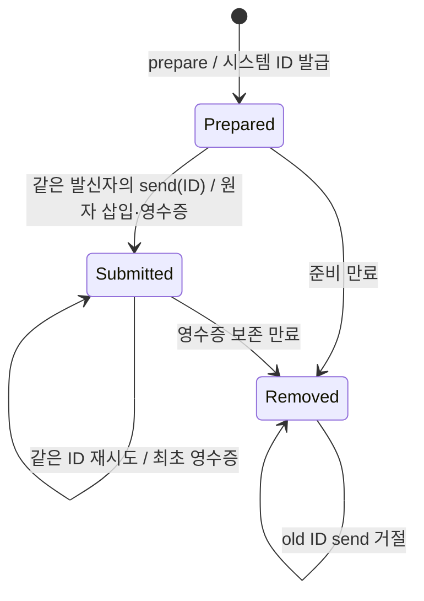
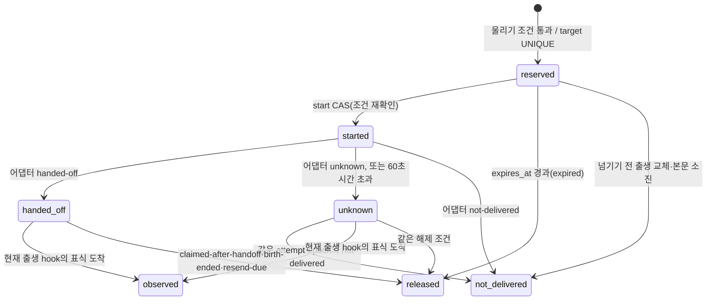

# 시스템 발급 메시지 ID와 재시도

릴레이의 기존 5초 주기는 `relay-tick` 한 요청으로 현재 세션 세대와 relay lease를 확인하고 두 heartbeat를 함께 갱신한다. pending 조회는 해당 transport가 필요한 경우만 포함한다. 오래된 세대·종료된 presence·만료된 lease는 갱신하지 않으며, heartbeat 자체는 실제 wake 관측이 아니다.

2.6.0의 새 메시지는 `prepare_session_message`로 준비하고 반환된 `messageId`만 `send_session_message`에 전달한다. 준비는 발신자·대상·본문·TTL을 고정하며 수신 큐·peer 관계·wake에 영향을 주지 않는다. ID는 공통 broker가 발급하고 기존 메시징 SQLite에 보존한다. caller가 ID를 만들거나 전송 때 내용을 바꿀 수 없다.



`schemaVersion: "1.0.0"`, `targetHost`, `targetSessionId`, `body`, 선택 `ttlSeconds`로 prepare를 호출한다. 이어 `schemaVersion`과 반환된 `messageId`로 send를 호출한다. 두 호출의 `_sessionBinding`은 기존 host hook이 결속하며 별도 사용자의 승인·principal을 만들지 않는다. 발급되지 않은 ID, 다른 sender, send의 추가 body/target/TTL은 큐 삽입 없이 거절한다.

prepare 응답이 유실되어 다시 준비하면 사용하지 않는 draft가 남을 수 있지만 전달은 일어나지 않는다. send 응답이 유실되면 이미 알고 있는 같은 발급 ID로 `get_session_message_status`를 조회하거나 send를 재시도한다. 최초 큐 삽입과 제출 상태·영수증 저장은 같은 `BEGIN IMMEDIATE` transaction으로 확정한다. broker 재시작이나 다른 연결의 동시 send에도 같은 ID로 다시 삽입하거나 expiry를 늘리지 않는다.

**unknown ID는 전송이 없었다는 증거가 아니다.** 이미 전송한 기록이 정리됐을 수 있으므로 보관한 영수증과 대조한다. 불명확한 전송을 무조건 새 prepare로 다시 보내지 않는다. 새 prepare는 새 전송 의도에 사용한다. 수신 모델의 업무를 exactly-once로 실행한다는 보장은 없다.

| 저장 대상 | 경계 |
| --- | --- |
| 미전송 draft | prepare부터 10분; sender별 100개, 전역 1000개 |
| 제출 영수증 | 전역 1000개, sender별 250개; 미ACK 메시지는 최초 메시지 expiry 이후 1시간, ACK된 메시지는 `min(메시지 expiry+1시간, 최초 ACK+1시간)`까지 보존 |
| draft·영수증 전체 | record JSON의 UTF-8 byte 합 최대 4 MiB; 전송 뒤 본문 중복 저장 제거 |
| 실제 수신 큐 | 기존 미ACK 메시지 최대 1000개·본문 합 4 MiB |
| 메시지 TTL | 첫 send부터 30~86400초, 기본 3600초 |

상한에서는 명시적으로 거절하며 미만료 기록을 강제로 지우지 않는다. 영수증이 정리된 ID도 unknown으로 거절해 새 메시지가 생기지 않는다.

sender별 영수증 상한은 협력하는 세션 사이의 공정성 장치다. sender는 host hook이 결속한 세션 식별자일 뿐 인증된 principal이 아니므로, 같은 OS 사용자의 의도적 우회를 막는 할당량으로 보지 않는다. send는 같은 transaction에서 정리 뒤 sender 상한, 전역 상한 순으로 검사하는 권위 검사다. prepare도 같은 방식으로 영수증 용량을 먼저 확인해 이미 상한에 닿았으면 draft를 만들지 않고 `no draft was created`로 거절한다. 이 prepare 검사는 입장 확인일 뿐이며, prepare와 send 사이에 용량이 차면 send가 거절하고 해당 draft는 준비 만료까지 남는다.

영수증 용량 거절은 효과가 없었음이 확정된 거절이다. 메시지는 큐에 들어가지 않았고 영수증도 발급되지 않았다. 도구 응답의 `error.code`는 기존 `MCP_UNAVAILABLE`이고, `error.details`에 `scope`(`sender` 또는 `global`)와 해당 범위에서 가장 먼저 만료되는 기록의 시각 `earliestReleaseAt`을 담는다. 그 시각 뒤에는 새 prepare가 성공할 수 있지만 다른 sender가 먼저 용량을 쓸 수 있으므로 보장은 아니다. send에서 거절된 `messageId`는 prepare 응답의 `expiresAt`(준비 만료)까지 `prepared`로 남는다. `earliestReleaseAt`이 그 `expiresAt`보다 이르면 그 시각 뒤 같은 `messageId`로 재시도할 수 있다. 그렇지 않으면 draft가 먼저 만료되므로 새로 prepare한다. 둘 다 하지 않는다. 둘 다 하면 한 의도가 두 메시지로 전달될 수 있다. 용량 거절을 받은 뒤 그 ID로 다시 send하지 않았는데 draft가 만료돼 같은 ID의 send가 unknown(`Issued message ID is unavailable`)으로 거절될 수 있다. 이 경우 그 ID는 앞선 확정 거절로 전달되지 않았음이 이미 확인됐으므로, 저장한 거절 응답과 대조한 뒤 새로 prepare해도 된다. 확정 거절 기록이 없는 unknown ID는 기존처럼 저장한 영수증과 대조하고 무조건 다시 준비하지 않는다. 응답을 받지 못한 불확실한 send는 이 경우가 아니며, 기존처럼 같은 ID로 status를 조회하거나 send를 재시도한다. 이전 broker에서 온 거절에는 `details`가 없으므로 기존 안내를 그대로 따른다.

ACK는 해당 수신 대상에 대해 broker에 claim 이력이 기록되고 원 인수 영수증이 일치하는 메시지만 처리한다. 인수 응답의 본문과 `claimReceipt`를 같은 처리 문맥에 보존하고, 처리한 `messageIds`에 대응하는 `receipts: [{messageId, claimReceipt}]`를 반환한다. 최신 영수증을 조회하거나 메시지 ID 캐시에서 자동 선택해 붙이지 않는다. 아직 인수하지 않은 메시지, 다른 수신 대상, 모르는 ID, 영수증 누락·불일치는 메시지 상태·제출 영수증 만료·세션 활동 시각을 바꾸지 않는다. 인수 이력은 전달 대상으로 선택했다는 기록이며 실제 소비·업무 완료·권한의 증거는 아니다. 임대만 만료되고 재인수가 없으면 원 영수증의 늦은 ACK는 성공한다. 다른 회차가 재인수하면 이전 영수증은 효력을 잃고 새 회차를 확정할 수 없다.

ACK는 처음 성공한 ACK에서만 영수증 만료를 줄인다. 두 번째 ACK, 대상이 아닌 세션의 ACK, 모르는 ID의 ACK는 만료를 바꾸지 않으며, 줄인 만료는 다시 늘지 않는다. 따라서 ACK 후 1시간이 지난 ID는 status가 unknown(`null`)이고 같은 ID의 send도 발급 ID 없음으로 거절한다. 이 규칙은 새로 기록되는 ACK에만 적용하며, 이전 버전이 ACK한 기존 영수증의 만료를 소급해 바꾸지 않는다. 영구 tombstone이나 별도 DB·daemon은 없다. status는 준비 상태, 기존 queued/delivered/acknowledged 상태 또는 큐 행이 정리된 뒤 제출 영수증과 `deliveryState: "unknown"`을 구별한다.

ACK 전 lease 재전달은 정상이며 같은 ID·본문을 유지한다. 중복 ACK는 최초 ACK 시각을 늘리지 않는다. ACK는 처리 확인으로, 업무 완료나 승인이 아니다. wake의 전달 결과가 불명확하면 기존 예약을 유지하고 새 wake 효과로 바꾸지 않는다. [peer 대기 판정](peer-wait-policy.md)의 nonce·generation·복귀 증거 만료 계약은 유지한다.

## 회차 영수증과 혼합 버전의 제약

새 인수마다 같은 트랜잭션에서 `claimReceipt`를 발급하고 본문과 함께 반환한다. 이 값은 `<deliveryAttempt>:<무작위 UUID>`이며 모델이 만들거나 수정할 값이 아니다. 훅 봉투의 `receipt.claimReceipt`가 원값이다. 공개 수신 확인 도구와 명령줄은 다음 형식으로 원값을 전달한다.

한 인수 응답의 전체 직렬화 크기는 기존과 같이 UTF-8 32,768바이트 이하다. 본문뿐 아니라 영수증을 포함한 응답 봉투 전체를 계산하므로 같은 본문 묶음도 이전보다 적은 수가 한 응답에 들어갈 수 있다. 요청의 최대 메시지 수는 상한이며 그 수를 한 번에 전달한다는 보장은 아니다. 바이트 상한 때문에 다음 메시지를 넣을 수 없으면 앞에서부터 담은 메시지만 인수하고 나머지는 큐에 남긴다. 소비자는 받은 묶음을 원영수증으로 확인한 뒤 다음 묶음을 인수하며, 전체 본문을 하나의 응답에 넣으려고 상한을 늘리거나 본문을 자르지 않는다. 메시지별 순서와 무손실 여부, 한글의 수신 조각 경계 처리는 이 배치 크기 변화와 별도로 검증한다.

```json
{"messageIds":["<원 messageId>"],"receipts":[{"messageId":"<같은 messageId>","claimReceipt":"<같은 인수 응답의 claimReceipt>"}]}
```

브로커는 `claim-receipts-v1` 기능과 엔드포인트의 `claimReceiptVersion: 1`을 표시한다. 새 클라이언트는 이를 지원하지 않는 실행 중 브로커를 `BROKER_CLAIM_RECEIPTS_REQUIRED`로 거부하며 별도 브로커를 자동으로 띄워 우회하지 않는다. 인수하는 다섯 연산은 요청 봉투에도 `claimReceiptVersion: 1`을 넣는다. 새 브로커는 이 표지가 없거나 다른 구형 소비자의 요청을 본문 인수 전에 거부한다. 이는 형식 지원 표시이며 호출자 인증이나 처리 완료 증거는 아니다. 조회 프레임은 그대로다.

메시징 저장소 형식은 2다. 이전은 기존 인수 회차를 `legacy_claim_attempt`에 한 번 보존하고 영수증·수신 확인 영수증 열을 추가한다. 공유 저장소의 이전 형식은 명시적 초기화 전까지 영역별 쓰기를 허용하지 않는다. 이전 뒤 이미 열려 있던 구형 연결도 새 회차를 영수증 없이 인수하거나 새 회차를 확정하면 데이터베이스 제약으로 거부된다. 구형 저장소 프로그램으로 되돌려 새 형식을 쓰는 복구는 지원하지 않는다. 운영 데이터 삭제·교체·수동 열 수정으로 우회하지 않는다.

이전 당시 이미 인수된 영수증 없는 역사 행은 기존 ID만의 수신 확인을 보존한다. 이 호환 분기는 이전에 여러 번 재인수된 행의 실제 처리자를 판별하지 못하므로 완전한 회차 소유권 보장을 제공하지 않는다. 해당 행도 새 프로그램의 첫 재인수부터 새 영수증을 요구한다. 구형 소비자 지원 중단과 역사 행 재전달·보류의 운영 선택은 설치 전에 기존 승인 범위와 대조해야 하며 이 구현이나 문서가 새 운영 권한을 부여하지 않는다.

세 호스트의 설치 파일 갱신만으로 살아 있는 이전 브로커나 소비자가 교체되지는 않는다. 기존 실행물 정상 종료·새 실행물의 기능 확인·원 영수증 왕복을 따로 검증해야 한다. 원 호스트 호출 증명의 도구명·인자 지문·호출 ID·유효기간·서명·일회 소비 검사는 유지하며 영수증으로 대신하지 않는다. 이 수정만으로 본문 직접 제출·유휴 깨우기·모든 실제 호스트 수용이 끝난 것은 아니다.

## hook 없는 CLI

`node mcp-server/dist/session-message-cli.mjs`의 stdin으로 아래 준비 요청을 보낸다.

```json
{"operation":"prepare","payload":{"sender":{"host":"spark","sessionId":"owner"},"target":{"host":"grok","sessionId":"worker"},"body":"검증 결과를 전달합니다.","ttlSeconds":600}}
```

성공 출력의 `data.messageId`를 보관하고 다음 전송 요청에 그대로 사용한다. 아래 ID 자리는 시스템이 반환한 실제 값으로 채운다.

```json
{"operation":"send","payload":{"sender":{"host":"spark","sessionId":"owner"},"messageId":"<returned-messageId>"}}
```

옛 send의 body/target/TTL이나 임의 ID 입력은 오류와 함께 종료하며 전달 효과가 없다. CLI도 broker와 같은 발급·보존·전이 계약을 사용한다. 본문과 비밀은 프로세스 인수에 넣지 않는다.

## 업데이트와 복구

기존 AGS MCP·relay·broker를 종료한 뒤 업데이트하고 재연결한다. 추가 `prepared_messages` 테이블은 기존 messages·키·nonce·presence 데이터를 보존한다. 기존 메시지는 계속 claim/status/ACK할 수 있지만 발급 이력이 없는 기존 ID로 새 send를 할 수 없다. 이전 broker와 섞이는 호환 경로는 이번 사용자 범위에서 제외했다.

문제가 생기면 운영 DB와 키를 지우지 않고 데이터를 보존해 조사한다. 구버전 재설치는 새 발급 ID·재시도 계약을 지킨다는 증거가 아니다. 새 테이블을 삭제하거나 DB를 덮어써서 복구하지 않는다. 실제 설치·실행 process의 후보 확인은 소스 검증과 별도로 수행한다.


## wake 알림: 초인종(doorbell) 모델

3.0의 wake는 "받은함을 보라"는 초인종이다. 본문 전달은 기존 claim/ACK가 맡고, wake는 본문 권한의 경계가 아니다. 본문은 nonce 없이도 턴 종료·도구 경계에서 인수된다. 설계와 근거는 [ags30-wake-doorbell-design.md](ags30-wake-doorbell-design.md)에 있다.

host에 넘긴 표식에는 수신 확인과 취소가 없다. Codex는 대기열을 영속 저장하고 Running·Interrupted·Shutdown 상태에서는 꺼내지 않는다. Claude는 보류한 메시지를 `dialogExpiry`(기본 5분) 뒤에 버린다. agy에는 표식 관측 hook 경로가 없다. 그래서 store는 표식의 소비를 기다리며 슬롯을 영구히 잠그지 않고, 시간과 본문 인수 경계로 슬롯을 비운 뒤 다시 울린다.

시도 하나가 `wake_nonces` 행 하나다. 대상당 활성 시도는 최대 하나이며(UNIQUE `wake_active_target`) 이것은 잠금이 아니라 슬롯이다. 재시도는 항상 새 행과 새 nonce로 하고, 끝난 행은 되살아나지 않는다. board의 `consume-wake`는 상태와 만료를 따지지 않고 이 대상의 표식으로 인식되는지만 확인한다.



`not_delivered`·`handed_off`는 저장값 `not-delivered`·`handed-off`다. `observed`·`released`·`not-delivered`는 끝난 상태다.

### 시도 상태

| 상태 | 의미 |
| --- | --- |
| `reserved` | 울리기로 정했고 아직 넘기지 않았다. 외부 효과가 없다. |
| `started` | start CAS를 통과했고 어댑터를 호출하는 중이다. |
| `handed-off` | host가 받았다고 응답했다. 소비 여부는 모른다. 전달이 아니다. |
| `unknown` | 넘긴 결과를 알 수 없다. |
| `observed` | 현재 출생의 hook이 이 표식을 봤다. |
| `released` | 관측 없이 끝났다. `release_reason`이 붙는다. |
| `not-delivered` | 확정적으로 넘기지 못했다. 외부 효과가 없다. |

- relay는 start CAS 때 transport 포트가 선언한 `resendBaseMs`를 `start-wake`에 넘기고, 결과를 `record-wake-outcome`에 넘길 때도 같은 값을 보낸다. broker는 양의 정수이고 24시간(`WAKE_RESEND_MAX_MS`) 이하가 아니면 요청을 거부한다. hook이 보낸 값은 쓰지 않는다.
- `started`가 60초(`WAKE_START_TIMEOUT_MS`) 안에 결과를 받지 못하면 `unknown`이 되고, 이때 `outcome_at`과 `resend_due_at`을 함께 쓴다. 이 값은 어댑터 호출 timeout(5~10초)보다 길다.
- 결과 기록은 `started`나 `unknown`이고 attempt와 dispatch epoch가 같은 행에만 적용한다. 끝난 행에 늦게 온 결과나 start는 행을 바꾸지 않는다. 출생 상태(아래)는 attempt와 epoch가 맞으면 갱신하므로 늦게 온 실패도 재시도 대기와 실패 집계에 들어간다.

### 넘긴 결과 분류

어댑터는 `handed-off`, `unknown`, `not-delivered{kind, reasonCode}` 셋 중 하나만 돌려준다. `handed-off`나 `unknown`을 기록하면 출생 상태의 연속 실패 수를 0으로 되돌린다.

- `not-delivered`·`transient`: 연속 실패 수를 1 늘리고 backoff(상한 10분) 뒤에 다시 시도한다. 연속 5회(`WAKE_FAILURE_LIMIT`)에 닿으면 보고는 `degraded`/`wake-failing`이고, 생존성을 위해 backoff 상한으로 계속 시도한다. 예: 시작 직후 Codex의 `No active session found`.
- `not-delivered`·`prerequisite-missing`: 이 출생의 실행 환경에 필수 조건이 없다(실행 파일 ENOENT, messaging socket·token env 없음, project id·agentapi 없음, 메타데이터 불일치). 이 출생 동안 다시 울리지 않고 보고는 `degraded`/`wake-prerequisite-missing`이다. 출생이 바뀌면 다시 시도한다.

`unsupported`는 결과 값이 아니라 능력 선언(`idleWake: none`이거나 `peer-wake` 미지원)에서만 나온다.

### 출생별 깨우기 경로 상태

`wake_paths` 표는 (host, session, instance, birth generation)마다 연속 무응답 수(`streak`), 연속 실패 수(`failures`), backoff 끝 시각(`retry_not_before`), 전제조건 결손 사유(`prerequisite_missing`), 마지막 본문 인수 경계 시각(`claim_boundary_at`)을 둔다. 새 출생은 0에서 시작한다. prune은 최신 live 출생이 아니면서 활성 시도도 없는 행을 지운다.

`claim_boundary_at`은 `claimTurnEnd`, `claimHostWake`, 건너뛰지 않은 `claimDeferred`가 쓴다. MCP `claim`은 현재 live 출생이 있을 때만 그 출생에 쓴다. `observeNativeInput`, `clearDeferred`, 건너뛴 `claimDeferred`는 활동만 기록하는 경로라서 경계가 아니다.

### 울리기 조건

reserve할 때 보고 start CAS 안에서 다시 확인한다.

1. 현재 출생의 presence가 online이고, relay lease가 live이고, `peer-wake`를 지원한다.
2. 인수할 수 있는 본문이 있다.
3. 활성 시도가 없다.
4. 출생 상태에 `prerequisite_missing`이 없고 `retry_not_before`가 지났다.
5. 조용함: `claim_boundary_at`이 60초(`WAKE_QUIET_MS`)보다 이전이다. 인수 가능한 본문 중 가장 오래된 것이 10분(`WAKE_QUIET_MAX_MS`)보다 오래 기다렸으면 이 조건을 무시한다. 이것은 바쁜 세션에 표식을 덜 쌓는 최적화이고 정확성 조건이 아니다. hook이 없는 긴 작업(Codex의 긴 단일 도구 호출)은 이 조건으로 알 수 없다.

### 넘긴 시도의 해제와 재울림

`handed-off`·`unknown` 행은 다음 가운데 하나가 참이면 `released`가 된다.

| `release_reason` | 조건 |
| --- | --- |
| `claimed-after-handoff` | 출생 상태의 `claim_boundary_at`이 넘긴 시각(`outcome_at`) 이후다. 그 경계에서 대기 본문은 인수됐다. 표식 소비의 증거는 아니다. agy처럼 표식을 관측하지 못하는 host는 이 조건으로 슬롯을 비운다. |
| `birth-ended` | 시도의 출생이 더 이상 최신 live 출생이 아니다. |
| `resend-due` | `resend_due_at`이 지났다. |

`resend_due_at`은 `outcome_at + min(resendBaseMs × 2^streak, 24시간)`이다. `resend-due`로 끝나면 `streak`가 1 늘고, `observed`, `claimed-after-handoff`, 넘긴 시각 이후의 표식 도착 인수에서 0으로 돌아간다. `birth-ended`와 `not-delivered`는 streak를 바꾸지 않는다. 그래서 응답 없는 출생에 넘긴 시도 수는 `⌈log2(경과 시간/base)⌉ + 1` 이하이고, 24시간 상한에 닿은 뒤로는 하루 1개다. 조용한 live 세션은 무한정 막히지 않는다.

| transport | 넘기기 | `resendBaseMs` |
| --- | --- | --- |
| `codex-queue` | `codex queue --thread` | 20분 |
| `claude-inbox` | messaging socket(`priority:"next"`) | 10분 |
| `antigravity-queue` | `agentapi send-message` | 10분 |
| `codex-deferred`, `gemini-deferred` | 없음(`idleWake: none`) | — |

`reserved`는 `expires_at`이 지나면 무조건 `released`(이유 `expired`)가 된다. 넘기기 전에 다른 출생으로 바뀌었거나 본문이 모두 인수됐으면 `not-delivered`로 끝난다. 해제는 reserve·send·status 같은 기존 prune 지점에서 일어난다. 조회 도구인 `list_session_status`와 `get_session_message_status`도 prune을 부르므로 만료 기록 삭제와 해제를 일으킬 수 있다. 이 정리는 멱등이다.

공통 relay는 outcome·capability·dispatch 포트만 쓴다. transport 등록과 vendor 연결은 `wake-transport-*` 모듈과 조립 모듈 `wake-transports.ts`에 두고, 공통 상태에는 vendor 분기가 없다. 이 경로는 host 대기열의 목록·취소·삭제를 호출하지 않는다.

### hook 관측 경계

관측은 실제 `UserPromptSubmit` hook에서 adapter가 해석한 marker-only 입력과 기존 TrustStore의 비권위 source receipt를 함께 보낸다. broker는 저장된 서명·대상·정규화한 관측 digest·receipt TTL을 검증한 뒤 `BEGIN IMMEDIATE` 안에서 nonce, 현재 presence instance/birth generation과 claim 가능 본문을 확인한다. 일반 caller의 `approved`, normalized 입력 자칭, nonce 문자열만으로 관측을 만들 수 없다. 일반 peer 본문 receipt도 wake hook receipt로 사용할 수 없다. receipt 발급은 hook 코드에 있으며 공개 MCP 발급 도구는 없다.

receipt는 `authorityEffect: none`이다. 이 검사는 협력하는 로컬 hook 경로의 liveness provenance를 결속한다. 같은 OS 사용자가 코드를 실행하거나 source key를 변조할 수 없다는 보장, 사용자 승인·신원·업무 완료·W06 권위 채널 자격을 만들지 않는다.

- 현재 출생의 표식: 검증된 표식의 행이 현재 presence와 결합(instance·birth·transport·online·peer-wake)이 같으면 대기 본문을 인수한다. 행의 상태와 nonce 만료는 따지지 않는다. 활성 행이면 `observed`로 바꾸고, 이미 끝난 행이면 `late_observed_at`만 기록한다. 출생 상태의 `claim_boundary_at`도 갱신한다. 관측과 본문 claim은 한 transaction이며 batch/response budget 오류가 나면 둘 다 rollback한다.
- 다른 출생의 표식: 본문을 인수하지 않고 도착 증거만 남긴다.
- 끝난 행은 24시간(`WAKE_RESEND_MAX_MS`) 동안, 최대 1000행까지 보관한다. 보관 기간이 지난 뒤 도착한 표식은 미등록 nonce로 인식되지 않고 본문도 인수하지 않는다.
- 인수한 본문이 없고 행이 모두 끝난 상태면 응답에 `retired: true`가 붙는다. claim lease가 만료된 뒤 늦게 온 표식은 기존 재전달 규칙(lease 만료 → 재인수)처럼 본문을 다시 받을 수 있다. 중복 처리는 receipt·ACK와 수신자의 messageId 기준 중복 제거로 막는다.

delivery profile의 `blocksEmptyWakePrompt`가 켜진 host의 hook은 현재 managed wake가 검증됐는데 인수한 본문이 없거나(`recognized: true`, 빈 messages), 끝난 시도의 marker만 왔을 때(`retired: true`) `UserPromptSubmit`의 `decision: block`으로 그 marker prompt를 모델 요청 전에 막는다. host 화면에 marker가 한 번 보이는 것은 막지 않는다. 현재 내장 어댑터(Claude·Codex·Gemini·Antigravity)는 모두 이 값을 끈다. 따라서 지금은 빈 wake prompt를 막지 않고 기존 fail-open 처리를 따른다. `Stop`의 같은 decision은 continuation을 뜻하므로 이 처리에 쓰지 않는다. 메시지 전달 자체를 exactly-once 업무 실행으로 확대하지 않는다.

`wake-status`와 메시지 status의 `wake` diagnostic은 대상의 최신 시도의 상태·해제 이유·시각을 보여 주며 본문이나 nonce는 포함하지 않는다. 메시지 status의 `wake`는 그 메시지의 알림이 아니라 대상의 최신 알림이다.

### capability

| adapter | 주입과 idle 깨우기 | 넘긴 뒤 의미 |
| --- | --- | --- |
| claude-inbox | peer-wake·tool-boundary·turn-end, silent next | `handed-off`는 전달이 아니다 |
| codex-queue | peer-wake·tool-boundary, user-message | `handed-off`는 전달이 아니다 |
| codex-deferred | tool-boundary만, idle wake 없음 | idle 알림 발송 0, `unsupported` |
| antigravity-queue | peer-wake·tool-boundary, user-message | 관측 hook이 없어 `claimed-after-handoff`·`resend-due`로 해제 |
| gemini-deferred | idle wake 없음 | idle 알림 발송 0, `unsupported` |

antigravity의 queue wake 설정 env는 `AGENT_GOVERNANCE_ANTIGRAVITY_QUEUE_WAKE`다. 3.0은 옛 transport 이름 `gemini-queue`와 옛 env 이름을 받지 않는다.

### 보장과 남은 조건

- 위조한 nonce나 출처를 세탁한 표식으로 본문을 인수할 수 없고, 이전 출생의 표식은 현재 출생의 본문을 인수할 수 없다.
- 독립된 두 연결이 동시에 울려도 외부 호출은 한 번이다(start CAS). 결과를 기록한 뒤 응답을 잃어도 바로 다시 울리지 않는다.
- 미확인을 성공으로 보고하지 않는다. `handed-off`·`unknown`·`released`는 전달·소비의 증거가 아니고, status의 `deliveryState`를 바꾸지 않는다.
- Esc로 중단된 Codex 세션은 사용자가 재개할 때까지 어떤 설계로도 깨울 수 없다. 상태는 `wake-unanswered`로 보인다.
- Codex의 긴 단일 도구 호출 중에는 hook이 없어 조용함 조건이 동작하지 않는다. 그동안 붙잡힌 표식 1개가 턴이 끝날 때 나갈 수 있다.
- Claude 소켓의 `priority:"next"`와 agy의 `agentapi send-message`는 공개 계약이 아니다. 독립 모드는 시계가 단조가 아니어서, 시계가 뒤로 가면 그 폭만큼 상한이 늘어난다.
- 이 저장소 불변조건은 실제 host 대기열 항목 수의 실측을 대신하지 않는다. 적용 전 잔류 항목과 혼합 writer는 별도 검증 대상이다.

### 자동 깨우기 신호(autoWake)

`send_session_message`의 결과와 `get_session_message_status`의 미ACK 큐 행, 세션 현황판의 presence에는 조언용 `autoWake`가 붙는다. 계약은 `contracts/session-auto-wake-outlook.v2.schema.json`이며 `authorityEffect: "none"`이다. 발신 성공은 broker가 큐에 넣었다는 뜻이고, `autoWake`는 수신자의 idle 깨우기 경로를 지금 쓸 수 있는지에 대한 사실만 보고한다. 예측하지 않는다. 전달, 처리, 완료, 승인이나 권한의 증거가 아니고, 큐의 메시지를 지우거나 다시 보내지 않는다.

| state | reason | basisAt |
| --- | --- | --- |
| `available` | `relay-live`: 울릴 수 있다 | relay lease 갱신 시각 |
| `available` | `wake-in-flight`: 넘긴 뒤 관측창(60초) 안이다 | 넘긴 시각 |
| `available` | `wake-unanswered`: 관측창이 지났고 응답 근거가 없다. host가 붙잡았거나 버렸을 수 있다 | `resend_due_at` |
| `available` | `recipient-active`: 최근에 본문 인수 경계를 지났다 | `claim_boundary_at` |
| `available` | `retry-backoff`: 일시 실패 뒤 대기 중이다 | `retry_not_before` |
| `degraded` | `wake-failing`: 연속 일시 실패가 상한에 닿았다 | 마지막 실패 시각 |
| `degraded` | `wake-prerequisite-missing`: 이 출생에서 깨우기 전제조건이 없다. 경계 인수만 남는다 | 판정 시각 |
| `unsupported` | `no-idle-wake`: 능력 선언상 깨울 수 없다 | presence birth |
| `no-live-relay` | `presence-unknown`, `presence-not-online`, `relay-lease-missing` | 없음, presence lease 종료, 마지막 presence heartbeat |

`degraded`이면 메시지는 큐에 남고, 상대가 자기 턴 종료·도구 경계·입력에서 인수할 때까지 늦을 수 있다. 송신자는 상대의 처리가 지금 필요할 때만 확인된 전달 상태와 이 지연 가능성을 사용자에게 알린다.

presence lease가 끝나고 live relay가 없으면 presence `state`는 `unreachable`이나 `ended`이고 `autoWake`는 `no-live-relay`다. 현황판은 오래된 online을 보여 주지 않는다. relay는 SessionStart hook에서 뜬다. 그 뒤에는 주 세션의 입력, 도구 실행 뒤 경계와 턴 종료 hook이 현재 세대에 live relay가 없다는 broker 응답을 받았을 때만 그 세대의 relay를 다시 띄운다. 어댑터가 검증된 복구를 켰으면 `list-presence`가 내보내는 명시적 `relayLive`로 확인한 뒤(autoWake에서 추정하지 않는다) 시작 grant(`ensure-relay`)를 받고, 아니면 입력 관측·claim·`clear-deferred` 응답의 복구 정보로 한 번만 시도하며, 그 hook의 host process가 해당 세대가 보고한 host birth와 다르면 사유를 기록하고 띄우지 않는다. 이런 hook이 아직 실행되지 않은 세션, 예를 들어 재부팅 뒤 아직 turn이 없는 Codex 세션은 `no-live-relay`로 보이며 메시지는 큐에 남는다. broker가 답하지 않은 identity의 `autoWake`는 `null`이다.

#### 세대 식별(C2)

presence birth는 ms 해상도 ISO 문자열이다. 같은 instance가 이전 birth와 같은 ms에 다시 태어나면 두 세대가 같은 문자열을 가져, 이전 birth의 nonce가 현재 세대 claim을 얻을 수 있었다. `startPresence`는 rebirth의 시각이 이전 birth보다 늦지 않으면 이전 birth에 1ms를 더한 값을 쓴다. 살아 있는 lease의 갱신은 birth를 바꾸지 않는다. 별도 세대 ID 컬럼은 추가하지 않았다. 보존 기간이 지나 행이 지워진 뒤의 재등록은 아래 presence 보존 절을 따른다.

#### presence 보존과 현황판 조회

2.7.3까지는 `session_presence` 행을 지우는 코드가 없어 끝난 세션의 행이 계속 쌓였다(2.7.2부터 잠재). 현황판 조회는 broker의 `list-presence`가 저장된 모든 identity를 한 응답으로 돌려주었고, 응답이 한도(32 KiB)를 넘으면 client가 거절해 현황판의 모든 presence가 `unknown`, `autoWake`는 `null`이 되었다. store의 판정은 맞았고 전송 한도에서 막혔다.

보존: `prune`은 lease 끝(`lease_until`, 종료한 행은 종료 시각과 같다)이 24시간보다 오래된 presence 행을 지운다. 24시간은 현황판이 세션을 보여 주는 창(board의 24시간 보존)과 같아서, 현황판에 보이는 동안 끝난 세션은 `ended`나 `unreachable`로 보인다. 살아 있는 행(`ended_at` 없음, lease 유효)은 lease 끝이 미래이므로 지워지지 않는다. 같은 identity에 살아 있는 행이 있는 동안에는 그 identity의 가장 최근 행(birth 기준)도 남긴다. presence 조회, `birth-ended` 판정과 `autoWake`는 모두 이 가장 최근 행만 읽으므로, live identity의 presence, 해제 판정과 `autoWake` 상태는 정리 전후에 같다. live 행이 없는 identity는 다르다. 가장 최근 행이 지워지면 더 이른 행이 최신이 되어 표시되는 instance, 상태(`ended`/`unreachable`)와 기준 시각이 바뀔 수 있고, 행이 모두 지워지면 등록된 적 없는 identity처럼 `unknown`이며 `autoWake`는 `no-live-relay`/`presence-unknown`이다. 메시지, 영수증, wake 행과 relay lease 규칙은 바뀌지 않는다. 정리는 DELETE 한 문장이라 멱등이다.

검증된 부모 세대 기록이 없는 일반 presence에서 행이 지워진 instance가 다시 등록되면 새 행으로 들어가 birth가 등록 시각이 된다. 지워진 행은 lease 끝이 24시간 전보다 이르고 birth는 그보다 이르므로, 시계가 되돌아가지 않는 한 새 birth는 이전 wake의 birth generation보다 크다. 이는 부모 프로세스의 실제 생성 순서를 증명하지 않으며, 이미 정리된 역사 세대의 재등록을 구별하는 근거가 아니다.

##### 검증된 부모 세대 보존과 교체

AGS-D-0354 수리 뒤 broker가 실제 확인한 부모 PID와 출생토큰은 기존 `session_presence` 행에 보존한다. 이 행은 위의 시간 기반 정리에서 제외한다. 새 세대 B를 등록하고 이전 세대 A의 교체를 확정하는 작업은 같은 트랜잭션으로 처리한다. 교체된 A는 현재 presence 선택에서 제외하지만 A의 재등록을 거부하는 근거로 남긴다. 정상 미등록 C는 자신이 관측한 현재 B가 그대로인지 비교한 뒤 등록한다. 해시, 등록 시각이나 출생토큰의 문자열 순서로 세대의 전후를 추론하지 않는다.

기존 요청은 전체 presence 행 중 한 행씩 순환해 정리 후보를 읽는다. 이미 검증한 같은 PID의 다른 출생토큰 또는 PID 조회의 `ESRCH`로 원 신원의 사망을 확인한 경우만 삭제하며, 삭제 때 행과 보존한 세대 근거가 그대로인지 다시 비교한다. 권한 오류, 조회 실패·취소·시간 초과는 사망 근거가 아니다. 새 행이 계속 추가돼도 기존 순회 구간을 먼저 끝내며, 별도 주기나 프로세스는 추가하지 않는다. 요청의 기존 남은 예산을 넘으면 삭제하지 않는다. 살아 있거나 사망이 불명확한 보호 기록 총량에는 고정 상한이 없으므로 전체 저장소의 크기가 제한된다고 보장하지 않는다.

형식 번호 2를 유지하며 기존 행에 nullable 열 세 개를 추가한다. 보장은 수리된 broker가 실제 검증해 보존한 세대부터 적용된다. 이미 정리된 A의 이력은 사후 복원할 수 없고, 출생토큰의 동일 tick·재부팅 식별 한계를 넘는 보장을 추가하지 않는다. 구형 writer는 새 보호 열을 모르므로 혼합 실행의 보호를 보장하지 않는다. 설치 전 기존 생산자의 정상 종료와 세대 단절 확인은 별도 실행·검증 대상이며, 파일 생성이나 새 설치만으로 과거 살아 있는 A가 사라졌다고 판단하지 않는다.

조회: 서버는 현황판에 보이는 identity만 3개씩 묶어 `list-presence`의 `targets`로 요청하고, broker는 그 identity만 돌려준다. 3개는 모든 문자열 필드가 최대 길이이고 JSON escape로 6바이트가 되는 문자만으로 채워져도 응답 한도 안에 든다. broker는 `targets`가 1~3개가 아니면 거절하고, 응답이 한도를 넘으면 보내지 않고 명시적으로 거절한다. `targets` 없는 요청(2.7.3 이하 service)에는 저장된 모든 identity를 돌려주며, 한도를 넘으면 같은 거절을 한다.

서버는 broker가 받는 식별자 형식(`isBoundedIdentity`, broker와 같은 규칙)에 맞지 않는 identity는 요청하지 않는다. 그 identity와 broker가 명시적으로 거절한 묶음의 identity는 broker가 답하지 않은 것으로 보고 `unknown`, `autoWake: null`로 두며, 나머지 묶음은 그대로 표시한다. 거절이 아닌 실패(연결 실패, client deadline 초과, 응답 한도 초과)가 한 번 나면 남은 묶음은 요청하지 않고, 그 묶음과 남은 묶음의 identity를 모두 같은 방식으로 둔다. broker에 물었는데 행이 없는 identity는 `unknown`이고 `autoWake`는 `no-live-relay`/`presence-unknown`이다. 요청 수는 ceil(N/3)이고 묶음은 순서대로 보낸다.

조회 전체는 client deadline 하나(20초, 다른 broker 요청 하나와 같은 값)를 나눠 쓴다. 시간은 client와 같은 단조 시계로 재므로, 조회 중 시스템 시계가 바뀌어도 상한은 늘거나 줄지 않는다. 묶음마다 남은 시간만 client에 넘기고, 남은 시간이 없으면 더 요청하지 않는다. deadline에 걸린 묶음은 client가 연결을 끊고 거절이 아닌 실패로 끝나므로, 위 규칙대로 그 묶음과 남은 묶음을 모두 `unknown`, `autoWake: null`로 두고 앞서 받은 결과는 유지한다. 끊은 요청의 응답이 뒤늦게 와도 결과는 바뀌지 않는다. 그래서 broker가 응답하지 않거나, 응답은 하지만 묶음마다 느려도 조회 전체는 20초를 넘지 않는다. 2.7.5까지는 전체 상한이 없어, 묶음마다 요청 하나의 한도 안에서 느리게 답하는 broker에서는 대기가 묶음 수만큼 늘었다. 20초는 broker가 없어 새로 띄우는 첫 조회(기동 대기 최대 15초)가 끝날 수 있는 시간이고, 호스트의 MCP 도구 호출 제한(Codex 기본 60초)보다 짧다. 묶음을 동시에 보내지는 않는다. broker는 요청을 한 process에서 차례로 처리하므로 동시에 보내도 broker 쪽 시간은 줄지 않고, 정상 broker에서 300개 세션 조회는 약 0.5초다.

| service | broker | 현황판 presence |
| --- | --- | --- |
| 2.7.4 이상 | 2.7.4 이상 | 세션 수와 DB 크기에 관계없이 동작한다 |
| 2.7.4 이상 | 2.7.3, 2.7.2, 2.7.1, 2.2.6 | 이전 broker는 `targets`를 무시하고 모든 identity를 돌려준다. 응답이 한도 안이면 정상이다. 넘으면 첫 묶음이 응답 한도 초과(전송 실패)로 끝나 남은 묶음은 요청하지 않고, 2.7.3처럼 모든 presence가 `unknown`, `autoWake`가 `null`이다. 이전 broker는 presence 행을 지우지 않으므로 새 broker가 뜰 때까지 이어진다 |
| 2.7.3 이하 | 2.7.4 이상 | `targets` 없는 요청이라 모든 identity를 받는다. 보존 정리 뒤에는 24시간 안의 identity만 남지만, 그래도 한도를 넘으면 broker가 명시적으로 거절하고 이전 service는 모든 presence를 `unknown`으로 둔다 |

broker는 relay가 주기적으로 요청하는 동안 종료되지 않으므로, 업데이트 뒤에도 이전 broker가 계속 돌 수 있다. 앞의 안내대로 기존 AGS MCP·relay·broker를 종료한 뒤 재연결한다.

#### 이관(3.0, user_version 3)

CHECK와 DEFAULT `'legacy'`는 제자리에서 바꿀 수 없으므로 `wake_nonces`를 한 transaction 안에서 다시 만든다. 기존 상태는 `submitted`→`handed-off`, `not-submitted`→`not-delivered`, `expired-unobserved`→`released`(이유 `migrated`), `started`→`unknown`으로 옮기고, `legacy` 행은 지운다. `late_observed_at`이 있는 옛 `unknown`도 `released`(이유 `migrated`)가 된다. 옮긴 활성 행(`handed-off`·`unknown`)에는 `outcome_at`(없으면 `started_at`), `resend_base_ms` 10분과 `resend_due_at = outcome_at + 10분`을 채워 영구히 잠기지 않게 한다. `wake_active_target`은 새 활성 상태 목록으로 다시 만들고, `wake_paths`는 기존 활성 행의 출생마다 streak 0으로 채운다. 옛 transport 값 `gemini-queue`는 presence·relay lease·wake 행에서 `antigravity-queue`로 바꾼다. 도중 실패는 전체를 rollback한다. 2.x broker는 version 3 DB를 열지 못한다(더 높은 version 거절). broker 프로토콜 버전도 2.0.0으로 올라가므로 2.x client·relay와 섞이지 않는다. 기존 AGS MCP·relay·broker를 종료한 뒤 업데이트한다.

독립 process fixture와 번들 검사는 실제 host 설치·wake 관측을 대신하지 않는다. 실제 설치·양 host 실측은 별도 W07/출하 검증이며 로컬 PASS로 승격하지 않는다.
